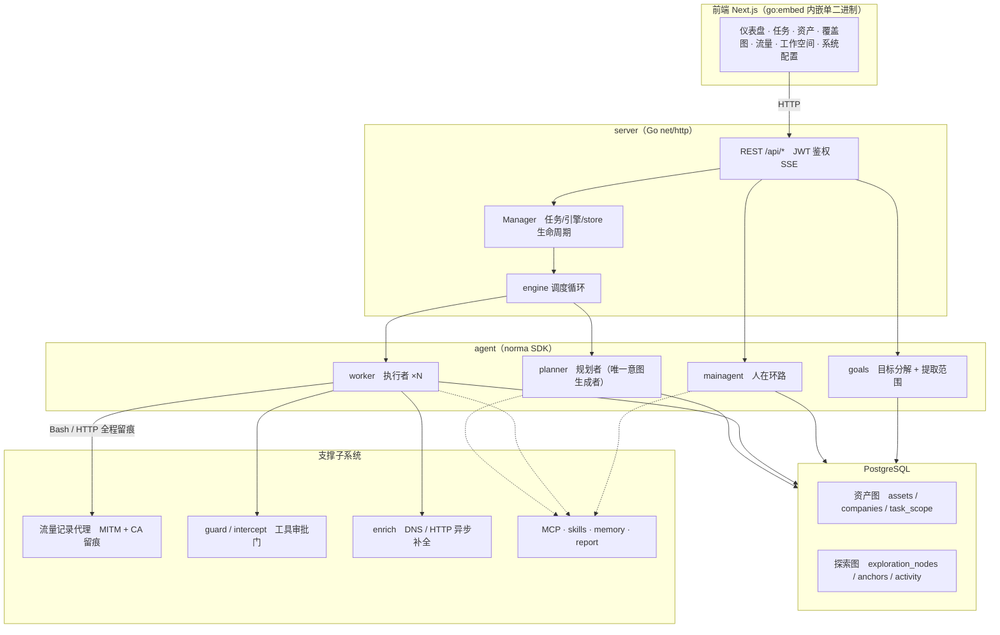
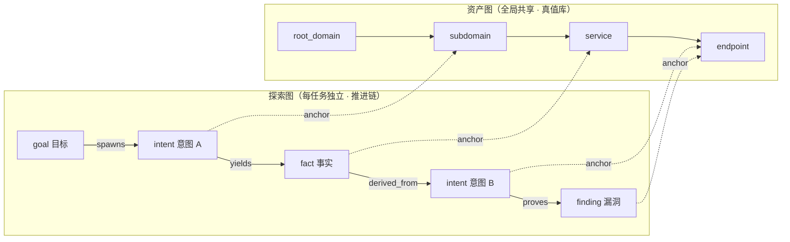
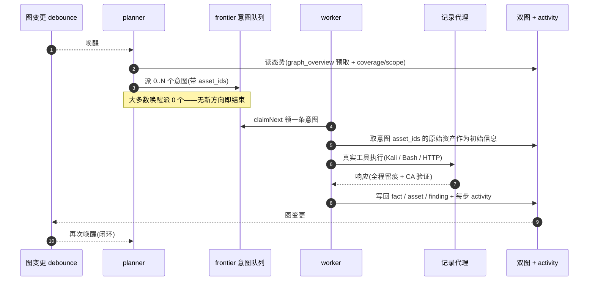
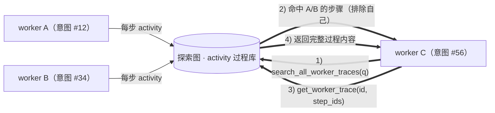
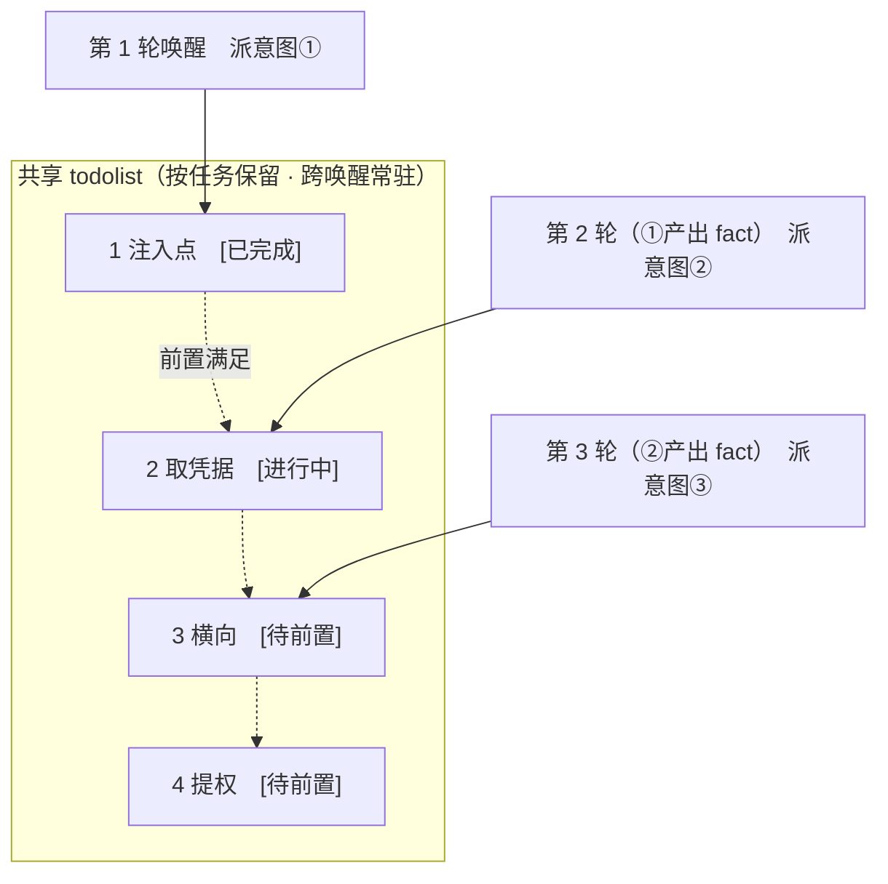

<!-- 中文说明开始 -->

# 🇨🇳 中文详细说明 · ARTEX（AI 自主渗透测试系统）

<!-- 徽章区开始 -->
<p align="center">
  <a href="https://github.com/aiwozhonghua81/ARTEX-"></a>
  
  
  
  
  
</p>
<p align="center">
  
  
  
</p>
<p align="center">
  
</p>
<!-- 徽章区结束 -->

> **本节是给中文读者写的通俗版说明，面向完全没用过渗透测试工具的朋友。**
> 下方「↓ 上游 README 原文开始 ↓」以下是上游 [RuoJi6/ARTEX](https://github.com/RuoJi6/ARTEX) 的原文，**一字未删**，包含完整的安装、更新、配置说明。

---

## ⚠️ 先看这一条：合规提醒

ARTEX 是一个**渗透测试**工具，也就是俗称「黑客工具箱」的东西。仓库里写得很清楚：

> **严禁将本工具对任何网站、线上服务或联网系统发起扫描、探测、利用或攻击**（无论是否获得授权、是否为自有资产）。

- ✅ **可以做**：在自己电脑上、在完全隔离的本地环境里（比如自己搭的靶场、CTF 练习环境），研究源码、理解原理、学习技术
- ❌ **不能做**：拿它去扫任何真实存在的线上网站或服务
- 使用者要自己遵守所在地的法律法规（中国大陆包括《网络安全法》《数据安全法》《个人信息保护法》）
- 一切后果由使用者自己承担

许可证是 **AGPL-3.0**（比 MIT 严格）：如果你改了它还部署成在线服务给别人用，**必须公开你的修改后源码**。

---

## 🧐 一、这是什么（一句话说清）

**ARTEX 是一个让 AI 自己去「黑」目标网站的系统 —— 相当于把一群有自主性的安全研究员关进黑盒里，让它们自动侦察、自动找漏洞、自动出报告。**

拆开看三个部分：

| 部分 | 是什么 | 用大白话说 |
| --- | --- | --- |
| **Go 后端** | `cmd/artex` 编译出的单个二进制文件 | 整个系统的「大脑 + 服务器」，负责调度 AI、存数据、提供 API |
| **Next.js 前端** | 浏览器里的管理控制台 | 你的「驾驶舱」，看仪表盘、管任务、看漏洞报告 |
| **AI Agent 层** | 基于 `norma` SDK 的多智能体系统 | 真正干活的一群「AI 员工」 |

### 打个比方

你要做一次「网站安全体检」，传统做法是：

1. 人工整理一份资产清单（有哪些域名、哪些接口）
2. 人工用 nmap / sqlmap / burp 一堆工具逐个测
3. 测完人工写报告
4. 同一类问题在 50 个接口上重复 50 遍

ARTEX 的做法是：你告诉 AI「我要测 https://example.com，范围是这个公司」，然后：

- **goals（目标）**：AI 先把目标拆成「要探测哪些子域、哪些接口、找什么类型的漏洞」
- **planner（规划者）**：只负责「决定下一步该往哪个方向走」，是整个系统里**唯一**生成「意图」的角色
- **worker（执行者）**：几十个并发 worker，每个领一条意图，用真实的 Kali 工具去干，干完把结果写回数据库
- **mainagent（人在环路）**：你随时可以在界面上插话、纠正方向

**关键点**：不是「一个 AI 乱扫」，而是**有组织的多 AI 协作**，并且每一步都有留痕（流量录制）。

---

## 👥 二、适合谁用 / 能解决什么问题

### ✅ 适合你，如果你是

| 你是 | 你会得到什么 |
| --- | --- |
| **安全研究员 / 白帽子** | 一个能自动干活的测试平台，用来在授权范围内摸清自己的资产 |
| **甲方安全团队** | 批量资产体检的效率工具，AI 出初版报告，人来复核 |
| **想学渗透测试的学生** | 把工具链和攻击方法论串起来的完整实现，源码可读可改 |
| **AI Agent 方向的开发者** | 一个生产级的多智能体系统参考实现：双图架构、事件驱动引擎、审批门、过程级信息交换 |
| **做安全产品的工程师** | 「AI + 安全」这条路的现成底座，二次开发很快 |

### 🎯 能解决的具体问题

1. **「资产清单整理」太耗时** —— 支持从 ScopeSentry 直接同步资产，按公司范围自动归并
2. **「同一类漏洞要测 100 个接口」** —— 批量 worker 并发执行
3. **「攻击链断了」** —— planner 用跨轮共享的 todolist，把「发现注入点 → 拿凭据 → 横向 → 提权」这种有依赖关系的多步链**按顺序**推进，不会一次性乱派
4. **「AI 之间重复劳动」** —— worker 之间可以按关键字检索**其他 worker 的执行过程**，直接复用别人的观察
5. **「报告写起来太累」** —— 同一实际缺陷会被自动归并成一个「漏洞文件夹」，生成一份统一报告，原始上报全部保留
6. **「改完了不知道修没修好」** —— 内置「漏洞复测」Agent，结论分「仍可复现 / 已修复 / 无法确认」

---

## ⚙️ 三、核心功能

### 3.1 双图架构 —— 这是整个系统的灵魂

ARTEX 把「**目标是什么**」和「**测到了什么程度**」拆成两张独立的图：

| | 资产图（Asset Graph） | 探索图（Exploration Graph） |
| --- | --- | --- |
| **范围** | **全局共享**，所有任务共用一份真值库 | **每个任务独立**，记录这次探索的思考过程 |
| **节点** | `root_domain` / `subdomain` / `ip` / `service` / `app` / `endpoint` | `goal`（目标）/ `intent`（意图）/ `fact`（事实）/ `finding`（漏洞）/ `hint`（提示） |
| **边** | 域名 → 子域 → 服务 → 端点 的父子关系 | `spawns` / `derived_from` / `yields` / `proves` 等**血缘链** |
| **回答的问题** | 「我们公司到底有哪些资产？」 | 「这个结论是从哪条思路来的？」 |

**两张图靠锚点相连**：表 `exploration_anchors(node_id, asset_id)` 把意图/事实/漏洞锚定到具体资产上。于是：

- 从「探索方向」能看它打的是哪些资产
- 从「某个资产」能反查它被哪些意图测过、得出过哪些结论
- 支撑起**资产测试覆盖度**和**资产覆盖图**（范围内资产 + 已测高亮）

### 3.2 事件驱动的引擎

```
图变了 → 唤醒 planner → planner 派意图 → worker 领意图执行
  ↑                                              ↓
  └────── 写回 fact / asset / finding ←──────────┘
```

**大多数唤醒 planner 会派 0 个意图**（没有新方向就结束）—— 这一点很关键，说明系统不会为了「干点活」而乱跑。

### 3.3 Worker 之间的「过程级」信息交换

很多有价值的观察（某个报错、某段响应、某个隐藏参数）出现在一个 worker 的**执行过程**里，还没被写成正式的 fact。ARTEX 提供三个工具解决这个：

| 工具 | 作用 |
| --- | --- |
| `search_all_worker_traces(q)` | 在本任务**其他 worker** 的执行过程里按关键字检索（自动排除自己这条意图） |
| `list_worker_traces` | 看有哪些 work 跑过 |
| `get_worker_trace(intent_id, step_ids=[…])` | 取某个 worker 具体几步的完整内容 |

**效果**：worker C 能直接复用 worker A 在第 3 步看到的报错信息，不用自己重跑一遍。

### 3.4 审批门（guard / intercept）

worker 想执行某些敏感命令时，会被**卡住**，弹出一个审批对话框等你确认。

- 全局「审批记录」
- 任务内「拦截审批」
- 对话里的审批卡片

三处都能展开看详情（结构参考 AegisHook 的审批详情组件，沿用 ARTEX 自己的组件和主题）。

### 3.5 流量录制代理（MITM）

`-proxy :8788` 启动一个中间人代理，**全程录下** worker 发出的 HTTP 请求和收到的响应，包括 CA 验证细节。

**为什么重要**：漏洞报告里光写「存在 SQL 注入」没有说服力，有了流量包才能证明「真的能打穿」。仓库里有专门的文档 `docs/漏洞流量证据.md`。

### 3.6 漏洞归并与统一报告

同一任务内，Reporter（报告 agent）依据**目标、接口参数、权限边界、根因及验证证据**判断是否同一实际缺陷，形成「漏洞文件夹」。

- 只是类型或名称相同 → **不会**自动归并
- 严重程度、接口、后端或读写影响不同 → **仍可能是**同一漏洞
- 共用登录入口或令牌 → **不能单独**证明同一根因
- 证据不足时会提「人工建议」，需要你点「确认归并」

文件夹标题栏显示 `严/高/中/低` 数量统计（按原始记录数），独立漏洞数按文件夹去重。

### 3.7 漏洞复测

任务详情 → 「复测」页签 → 勾选漏洞 → 填写可选的修复版本/测试条件 → 发起复测。

- 会创建**独立的复测 Agent 会话**
- 结论分三类：**仍可复现** / **已修复** / **无法确认**
- 结论为「已修复」时自动把漏洞状态改成「已修复」
- 不需要重新启动原来的扫描任务

### 3.8 任务情报（凭据与敏感数据集中管理）

在「系统配置 → 任务情报」开启 **Agent 自动记录**后，worker 可以调 `record_intelligence` 上报凭据和线索。

- 开关**默认关闭**，关闭时不注入情报工具、不额外消耗 token
- 开启会增加提示与上报的 token 消耗
- 情报随任务归档、恢复、删除
- 归档格式 v4，仍支持读 v1–v3

### 3.9 远程 MCP 接入

系统设置里可以选 `http`（Streamable HTTP）或 `sse`（旧版 SSE），让外部 MCP 客户端连进来。

- SSE 用 `GET /sse` 建立事件流，再通过服务返回的 `/message?sessionId=...` 接收 JSON-RPC 请求
- 配置时 URL 填 `/sse`，请求头按 `Authorization=Bearer <token>` 填写

### 3.10 通知渠道

`notify/` 包支持多种推送：**Email、飞书、钉钉、HTTP webhook**，还带脱敏（mask）和 Markdown 渲染。

### 3.11 其他支撑

- **LLM 池**（`llmpool`）：多个 LLM 端点的健康检查与轮换
- **LLM 录制**（`llmrec`）：录制 LLM 调用，用于复盘
- **异步补全**（`enrich`）：DNS / HTTP 信息的异步补全
- **自定义工具**（`customtool`）：用户自己加工具
- **技能**（`skills/`）：内置 3 个 —— `api-recon`（API 侦察）、`playwright-cli`（浏览器自动化）、`scopesentry`（资产同步）

---

## 🚀 四、怎么快速上手

### 4.1 先决条件

| 需要什么 | 说明 |
| --- | --- |
| **PostgreSQL** | 必需，系统的所有数据都存这儿 |
| **LLM API Key** | 必需（探索要用），`ANTHROPIC_API_KEY` 或 `OPENAI_API_KEY`，也可以在 UI 里配 |
| **Docker**（推荐） | 一键部署走这条路 |
| **Go + Node.js**（源码编译才需要） | Go 版本见 `go.mod`（`go 1.26.10`），前端用 Node.js 22 |

### 4.2 方式一：一键安装脚本（推荐）

```bash
git clone https://github.com/RuoJi6/ARTEX.git
cd ARTEX
./install.sh
```

脚本会先检测 Docker（没装会问你是否自动安装），然后让你选：

- **① 全部 Docker**：填一个 Postgres 密码（**可以直接回车随机生成**）→ 自动写 `.env` → `docker compose up -d`
- **② 本地运行**：选数据库（连已有的 / 用 Docker 起一个）→ 生成 `config.json` → `go` 编译内嵌单二进制 → 启动

装好后打开 **http://localhost:8787**，**首次进入 `/setup` 设置管理员密码**。

### 4.3 方式二：Docker Compose（手动）

```bash
git clone https://github.com/RuoJi6/ARTEX.git
cd ARTEX
cp .env.example .env          # 填 POSTGRES_PASSWORD，可选 ANTHROPIC_API_KEY
docker compose up -d          # 拉取 ruoji6/artex 镜像 + postgres
# → http://localhost:8787
```

镜像里已经带了常用工具：`ripgrep` / `curl` / `vim` / `npm` / `nmap` 等。
`./skills` 和 `./data` 用绑定挂载持久化 —— **改 skill 不用重建镜像**。

`.env` 关键项：

```dotenv
ARTEX_IMAGE=ruoji6/artex
ARTEX_TAG=latest          # 可固定为 v0.3.17 这样的具体版本
POSTGRES_USER=artex
POSTGRES_PASSWORD=your-password-here
POSTGRES_DB=artex
ANTHROPIC_API_KEY=
OPENAI_API_KEY=
```

镜像支持 `linux/amd64` 和 `linux/arm64`，Docker 会自动选匹配架构 —— **ARM64 的 Kali 机器不用自己编译**。

### 4.4 方式三：下载预编译二进制（Releases）

从 [Releases](https://github.com/RuoJi6/ARTEX/releases) 下载对应平台的 zip，解压后得到：

```
artex          ← 主程序
start.sh       ← 守护脚本（Windows 是 start.bat）
skills/        ← 技能包
config.example.json
```

```bash
cp config.example.json config.json   # 填好 database 连接
./start.sh                           # → http://localhost:8787
```

> ⚠️ **一定要用 `./start.sh` 启动，不要直接跑 `./artex`。**
> `start.sh` 是守护脚本：程序退出后按退出码决定是否重新拉起，**页面上的「一键更新」靠它完成换装**。直接跑 `./artex` 的话，更新完就不会被拉起了。
>
> 后台常驻：`nohup ./start.sh >artex.log 2>&1 &`

平台选择：Linux ARM64（含 ARM64 Kali）选 `linux-arm64`，x86_64 选 `linux-amd64`。

### 4.5 方式四：从源码编译单二进制

```bash
# 1) 前端静态导出
cd web && npm ci && npm run build:static && cd ..
# 2) 拷进内嵌目录
cp -r web/out server/webui/dist
# 3) 编译（-tags embedui 才内嵌前端）
CGO_ENABLED=0 go build -tags embedui -o artex ./cmd/artex
./start.sh
```

### 4.6 方式五：构建跨平台 Release 包（维护者用）

```bash
./build.sh --release
# 产物：dist/artex-0.3.3-*.zip
```

默认生成 Linux amd64/arm64、macOS amd64/arm64、Windows amd64 五个平台的 zip。

### 4.7 本地开发与测试

```bash
./dev.sh    # 后端(:8787) + 流量代理(:8788) + 前端 next dev(:5173) → http://localhost:5173
```

- 后端：`go run ./cmd/artex`（不带 `-tags embedui` 则不内嵌前端）
- 前端：`cd web && npm run dev`（`/api` 反代到后端，带热更新）
- 测试：`go test ./...`
- Mock 预览（不需要后端）：`cd web && NEXT_PUBLIC_MOCK=1 npm run dev`

### 4.8 配置文件格式（`config.json`）

```json
{
  "database": {
    "host": "127.0.0.1", "port": 5432,
    "user": "artex", "password": "yourpass",
    "dbname": "artex", "sslmode": "disable"
  }
}
```

也可以用环境变量 `ARTEX_PG_DSN` 直接覆盖整个连接串。

LLM 配置（也可以在 UI 的「LLM 配置」页填）：

```bash
export ANTHROPIC_API_KEY=sk-...
# 可选
export ARTEX_LLM_PROVIDER=
export ARTEX_LLM_MODEL=
export ARTEX_LLM_BASE_URL=
export ARTEX_LLM_PROXY=
```

### 4.9 常用启动参数

```bash
./start.sh -addr :8787 -proxy :8788
```

- `-addr` —— 前端 + API 端口（默认 `:8787`）
- `-proxy` —— 流量录制代理端口（默认 `:8788`）

`start.sh` 会把参数**原样透传**给 `artex`。

### 4.10 在线 Demo（不用自己装就能看界面）

- 地址：https://artex-demo-ruoji6.vercel.app/
- Demo **只运行 `web/` 前端**，构建时启用 `NEXT_PUBLIC_MOCK=1`
- **不需要** Go、PostgreSQL 或模型密钥
- 界面是**模拟数据，不执行真实扫描**

---

## 🩺 五、常见问题 / 注意事项

### 坑 1：更新会中断正在跑的任务

页面「一键更新」本质是**换二进制 + 重启**。请在空闲时做。

### 坑 2：更新失败不会留下坏程序

机制设计得很稳：
- 校验或冒烟测试不通过 → 丢弃暂存件，继续跑当前版本
- 换装后的新版连续 3 次启动失败 → 自动回滚到 `artex.old`（失败的那个留作 `artex.failed` 排查）
- 上一版本保留为 `artex.old`，卡片上有「回滚到上一版本」按钮
- ⚠️ **但数据库结构不会回退**，回滚前请确认

### 坑 3：Docker 下只换程序、不换镜像

镜像里的 playwright / nmap 等工具链**不会**跟着程序升级。而且 `docker compose up -d` 重建容器后会退回镜像自带的版本。

要连镜像一起升：

```bash
docker compose pull artex && docker compose up -d artex
```

### 坑 4：反代不关缓冲，SSE 一直转圈

SSE 是长连接 + 持续推送，**反代必须关闭缓冲**，否则浏览器连上了却收不到事件。

Nginx 关键配置：

```nginx
location / {
    proxy_pass http://127.0.0.1:8787;
    proxy_buffering off;         # ← SSE 关键
    proxy_cache off;
    proxy_read_timeout 3600s;
    proxy_http_version 1.1;
    proxy_set_header Connection "";
}
```

好消息是：前端和 API/SSE 都由**同一个后端端口**（`:8787`）提供，实时活动流走**同源**地址，所以**不需要配置 `NEXT_PUBLIC_SSE_BASE`**，公网只开 443、8787 留在内网即可。

### 坑 5：忘了 HTTP Basic Auth 的密码

改密码需要验证原密码 + 二次确认新密码（**这不是 TOTP 那种独立第二因素**）。如果忘了独立验证密码，可以连数据库执行：

```sql
UPDATE settings
SET value = jsonb_set(value::jsonb, '{enabled}', 'false'::jsonb)::text,
    updated_at = now()
WHERE key = 'auth.http_basic';
```

然后重启 ARTEX，用原有 ARTEX 账号登录后重新配置。

### 坑 6：Docker 里 `127.0.0.1` 指容器自己

如果你在 Docker 里配置代理地址，`127.0.0.1` 指的是**容器自身**，不是宿主机。宿主机上跑的代理要写容器能访问的地址，比如 Docker Desktop 通常是 `http://host.docker.internal:7897`。

### 坑 7：数据库迁移不用手动执行

`artex` 每次启动会**幂等重跑** `schema.sql`（含 `ADD COLUMN` / `CREATE INDEX IF NOT EXISTS`），也就是**「重启即迁移」**。

但升级前仍建议先备份 `./data` 和数据库。

### 坑 8：忘了启动时数据库密码没改

`docker-compose.yml` 里写的是 `${POSTGRES_PASSWORD:?请在 .env 设置 POSTGRES_PASSWORD}` —— **没设就直接报错退出**，这是故意的。`.env.example` 里默认是 `change-me-please`，**必须改掉**。

### 坑 9：并发 work agent 数量

默认每个任务 3 个 work agent，在「系统设置」里配置。调太大容易把 API Key 打爆或者触发上游限流。

### 坑 10：`/v1/*` 和 `/health` 不受安全入口影响

「安全入口」把控制台从 `/` 移到 `/<入口>`，`/health` 和 `/v1/*` 不受影响。它是**额外的入口隐藏措施，不代替登录认证**。保存设置后记得记录新的登录地址。

---

## 🗂️ 六、目录结构速览

```
ARTEX-/
├── cmd/artex/              ← 程序入口（main.go，编译成单个二进制）
├── server/                 ← HTTP 层（net/http）
│   ├── server.go             主路由
│   ├── auth.go / basic_auth.go   JWT 鉴权 / HTTP Basic Auth
│   ├── manager.go            任务、引擎、store 的生命周期托管
│   ├── engine.go             引擎调度循环
│   ├── conversations.go      会话
│   ├── findings*.go          漏洞相关（归并、报告、复测、流量）
│   ├── intercept.go          拦截审批
│   ├── llmpool.go / llmretry.go  LLM 池与重试
│   ├── schedules.go / calendar_schedule.go  定时任务
│   ├── intelligence.go       任务情报
│   ├── sync_scopesentry.go   ScopeSentry 资产同步
│   ├── update.go             在线更新
│   └── webui_embed.go        前端内嵌
├── agent/                  ← AI Agent 层（norma SDK）
│   ├── planner.go            规划者（唯一意图生成者）
│   ├── worker.go             执行者
│   ├── mainagent.go          人在环路
│   ├── goals.go              目标分解与范围提取
│   ├── tools.go              工具集（双图暴露成 LLM 工具）
│   ├── toolcatalog.go        工具目录
│   ├── finding_recorder.go   漏洞记录
│   ├── retester.go           漏洞复测 agent
│   ├── intelligence.go       情报上报
│   ├── credentials.go        凭据处理
│   ├── capture.go            流量捕获
│   └── promptcatalog.go      提示词目录
├── db/                     ← 数据层（PostgreSQL / pgx）
│   ├── schema.sql            表结构（启动时幂等执行）
│   ├── assets.go              资产图
│   ├── exploration.go         探索图
│   ├── task_scope.go          任务范围
│   ├── findings.go            漏洞
│   ├── finding_cases.go       漏洞归并
│   ├── intercept.go           拦截
│   ├── llm_usage.go / llmhealth.go  LLM 用量与健康
│   ├── tasks.go / task_archives.go  任务与归档
│   └── settings.go            系统设置
├── web/                    ← Next.js 前端（静态导出后内嵌）
│   ├── src/
│   ├── package.json
│   └── vercel.json
├── traffic/                ← 流量录制代理（MITM + CA 留痕）
│   ├── proxy.go              代理主逻辑
│   ├── evidence.go           证据收集
│   └── archive.go            归档
├── guard/                  ← 审批门（工具执行前拦截）
├── intercept/              ← 拦截执行与判定
├── enrich/                 ← DNS / HTTP 异步补全
├── llmpool/                ← LLM 连接池与健康策略
├── llmrec/                 ← LLM 调用录制
├── mcphttp/                ← MCP HTTP / SSE 客户端
├── notify/                 ← 通知渠道（邮件/飞书/钉钉/webhook）
├── report/                 ← 报告生成
├── evidence/               ← 证据存储
├── sidequestion/           ← 旁路提问
├── selfupdate/             ← 自更新
├── skills/                 ← 技能包（可用目录挂载覆盖）
│   ├── api-recon/            API 侦察
│   ├── playwright-cli/       浏览器自动化
│   └── scopesentry/          资产同步
├── config/                 ← 配置读取
├── db/schema.sql           ← 建表脚本
├── docs/                   ← 文档（如「漏洞流量证据.md」）
├── screenshots/            ← README 用的截图
├── cmd/, docker-compose.yml, docker-compose.bench.yml
├── Dockerfile, build.sh, install.sh, update.sh, dev.sh, reset-password.sh
├── .env.example, config.example.json
├── go.mod / go.sum          ← Go 依赖（norma、pgx、mitmproxy、dnsx…）
└── CHANGELOG.md / LICENSE (AGPL-3.0)
```

### 关键文件一句话解释

| 文件/目录 | 一句话说明 |
| --- | --- |
| `cmd/artex/main.go` | 整个系统的入口，一个二进制跑全部东西 |
| `agent/planner.go` | **唯一**能生成「意图」的角色，整个系统的调度核心 |
| `agent/worker.go` | 真正执行工具调用的 worker |
| `db/exploration.go` | 探索图的读写（goal/intent/fact/finding） |
| `db/assets.go` | 资产图的读写（跨任务共享的真值库） |
| `traffic/` | 流量录制 —— 漏洞报告的证据从这来 |
| `guard/` + `intercept/` | 审批门：敏感操作要人点头才放行 |
| `skills/` | 可热插拔的技能包，**改完不用重建镜像** |
| `db/schema.sql` | 所有表结构，**启动时幂等执行** = 重启即迁移 |
| `install.sh` | 一键安装，Docker / 本地编译二选一 |
| `build.sh` | 构建五个平台的 Release 包 |
| `docker-compose.yml` | PostgreSQL + ARTEX 两个服务 |

---

## 📊 七、本仓库说明

| 项目 | 说明 |
| --- | --- |
| **本仓库** | `aiwozhonghua81/ARTEX-` —— 一个 **fork（派生仓库）** |
| **上游项目** | **ARTEX**（AI 自主渗透测试系统） |
| **上游地址** | https://github.com/RuoJi6/ARTEX |
| **上游的原始出处** | https://github.com/Autumn-27/ARTEX（提交历史与 AGPL-3.0 许可证均保留自此） |
| **技术栈** | Go 1.26 后端 + Next.js 前端 + PostgreSQL |
| **许可证** | **AGPL-3.0**（衍生作品必须同样开源；网络提供服务也要公开源码） |
| **Docker 镜像** | `ruoji6/artex`（Docker Hub，由本仓库 GitHub Actions 构建） |
| **本仓库改动** | 仅在 README 顶部新增本中文说明区块；**未修改任何源码文件** |

### README 的结构

```
┌─────────────────────────────────────────────┐
│  👆 本节：中文详细说明（面向普通读者）        │  ← 本次新增
├─────────────────────────────────────────────┤
│  👇 下方：上游 README 原文（未删改）           │  ← 上游 RuoJi6/ARTEX 撰写
└─────────────────────────────────────────────┘
```

- 上游 README 共 **630 行**，本身就是中文，内容非常详尽：12 张界面截图、5 种安装方式、5 种更新方式、完整配置说明（含 Nginx 反代、HTTP Basic Auth）、详细的双图架构图和 Mermaid 流程图、以及**完整的许可与免责声明**。**这些内容全部保留在下方。**
- 本中文区块是**面向新读者的导读**，重点补充了：架构是怎么想的、每个坑的具体成因和后果、以及每个目录到底在干什么。
- **特别提醒**：下游的「许可与免责声明」章节（AGPL-3.0 + 严禁攻击线上系统）在原文里，请务必读完再使用。

---

## 📌 快速自查清单

- [ ] **已经明确自己的合法使用场景**（本地隔离环境 / 授权靶场）
- [ ] PostgreSQL 已就绪，`.env` 里的 `POSTGRES_PASSWORD` **已改掉默认值**
- [ ] LLM API Key 已配（`ANTHROPIC_API_KEY` 或 `OPENAI_API_KEY`）
- [ ] 首次访问 `/setup` 已设置管理员密码
- [ ] 用的是 `./start.sh` 启动（不是直接跑 `./artex`）
- [ ] 要对外暴露时：配了 HTTPS 反代 + 关闭了 SSE 缓冲 + 开了 Basic Auth
- [ ] 升级前备份了 `./data` 和数据库

---


## 🖼️ 界面截图一览
下面这些图都是**这个仓库里原本就带的真实截图**，不是画的示意图：

**① 仪表盘**


**② 与 AI 对话**


**③ 资产关系图**


**④ 发现结果**


**⑤ 任务列表**


**⑥ 运行日志**


<!-- 中文说明结束 -->

---

↓ **上游 README 原文开始**（以下内容来自 [RuoJi6/ARTEX](https://github.com/RuoJi6/ARTEX)，未做任何删改） ↓

<div align="center">

# ARTEX

AI 自主渗透测试系统（Go 后端 + Next.js 前端）


🌐 **在线 Demo**： [https://artex-demo-ruoji6.vercel.app/](https://artex-demo-ruoji6.vercel.app/)

</div>

本仓库为独立维护的 [RuoJi6/ARTEX](https://github.com/RuoJi6/ARTEX)，保留 https://github.com/Autumn-27/ARTEX 的原始提交历史与 AGPL-3.0 许可证。程序发布包从本仓库 Releases 下载，Docker 镜像 [ruoji6/artex](https://hub.docker.com/r/ruoji6/artex) 由本仓库 GitHub Actions 构建并发布。

---

## 截图预览

> 完整交互见[在线 Demo](https://artex-demo-ruoji6.vercel.app/)。

| 仪表盘（总览 / Token 消耗 / 活动流） | 任务列表 |
| :---: | :---: |
|  |  |

| 任务 · 执行过程（会话 / 工具调用） | 探索链路 |
| :---: | :---: |
|  |  |

| 发现 | 资产 |
| :---: | :---: |
|  |  |

| 资产覆盖图（力导向布局 · 已测高亮 · 节点折叠展开） |
| :---: |
|  |

| 流量录制 | 人在环路对话 |
| :---: | :---: |
|  |  |

| Agent 管理 | LLM 配置 |
| :---: | :---: |
|  |  |

| 拦截审批 | 后端日志 |
| :---: | :---: |
|  |  |


---

## 审批记录详情

全局「审批记录」、任务内「拦截审批」及对话中的审批卡片均支持展开查看详情。展示结构参考
[AegisHook 的审批详情组件](https://github.com/RuoJi6/AegisHook/blob/main/web/src/components/CallDetail.vue)，沿用 ARTEX 的组件和主题：


## 资产同步（ScopeSentry）

支持从 [ScopeSentry](https://github.com/Autumn-27/ScopeSentry) 直接同步资产数据，免去重复收集：

- 在「**资产同步**」页填 ScopeSentry 的地址与 API Key，接入数据源；
- 按**项目**或**任务**维度选择要同步的目标与资产类型（域名 / 子域 / IP / 端口 / 站点 / 端点…）；
- 一键导入并按公司资产范围归并，直接进入 ARTEX 的资产图供 agent 探索使用。

---

## 部署自己的在线 Demo（随正式 Release 自动更新）

Demo 只运行 `web/` 前端，构建时启用 `NEXT_PUBLIC_MOCK=1`，不需要 Go、PostgreSQL 或模型密钥。界面使用模拟数据，不执行真实扫描。

发布链路：正式版本的程序包、`SHA256SUMS` 和 Docker 镜像全部成功发布 → `release.yml` 的 `demo` job 调用 `demo.yml` → 检出该版本标签的提交 → 构建 Mock 前端 → 部署至 Vercel 的固定生产域名。普通 main 推送、仅创建标签、失败的发布、草稿和预发布版本都不会更新 Demo。新版本功能的演示数据仍需由维护者同步维护 `web/src/lib/mock/`。

### 首次配置 Vercel

1. 在自己的 Vercel 账号创建空项目，设置名称（例如 `artex-demo-ruoji6`）。保持 **Git 未连接**，避免每次提交都自动部署。`web/vercel.json` 也禁用了 Git 自动部署。
2. 在 **Settings → Build and Deployment** 中选择 **Next.js**、Node.js **22.x**，安装命令可覆盖为 `npm ci`，构建命令为 `npm run build`，Output Directory 保持默认。**Root Directory 留空**：此工作流从检出的 `web/` 目录调用 Vercel CLI，不能再填一层 `web`。
3. 在项目的 **Environment Variables** 中添加 `NEXT_PUBLIC_MOCK=1`，至少应用于 **Production**。不要设置 `NEXT_EXPORT=1`，也不要填写数据库连接或模型密钥。
4. 在项目 **Settings → General** 复制 **Project ID**；在团队 **Settings → General** 复制 **Team ID**（对应 `VERCEL_ORG_ID`）。确认 **Domains** 中有准备使用的生产域名。
5. 在 Vercel **Account Settings → Tokens** 创建部署 Token，范围选择项目所在团队，并设置适当有效期。将其直接保存到 GitHub 仓库 **Settings → Secrets and variables → Actions → Secrets**，名称为 `VERCEL_TOKEN`。令牌不要写入仓库、README 或聊天；到期后更新这个 Secret。

在同一 GitHub 设置页的 **Variables** 中添加：

| 变量 | 值 |
| --- | --- |
| `VERCEL_ORG_ID` | Vercel Team ID |
| `VERCEL_PROJECT_ID` | Vercel Project ID |
| `DEMO_URL` | 固定公开生产网址，含 `https://`，例如 `https://artex-demo-ruoji6.vercel.app` |

### 首次部署与重试

将配置合并到默认分支后，打开 **Actions → deploy-demo → Run workflow**，分支选 `main`，tag 留空或填写当前最新正式版（例如 `v0.3.21`）。工作流只接受已发布且包含五个平台程序包和校验文件的最新正式版，也能部署尚未包含此工作流的历史正式版。无需重新发 Release 或移动已有标签。

工作流会将这个专用 Demo 项目的框架设为 Next.js、Node 设为 22.x、根目录设为空、安装命令设为 `npm ci`、构建命令设为 `npm run build`，并确保 Production 环境的 `NEXT_PUBLIC_MOCK=1`，随后绑定 `DEMO_URL` 指定的域名。请使用独立项目；后续部署会继续维护这些配置。

成功后访问生产域名，并检查 `/demo-version.json` 中的 `tag`、`commit` 和 `mock: true`。确认可访问后，将 README 顶部和截图区域的旧 Demo 链接一起改为自己的生产域名。

此后按正常流程发布更高版本即可自动更新 Demo。若 Demo 部署失败，已发布的程序包和镜像仍然有效，旧 Demo 通常继续提供服务；修复设置后单独重跑 `deploy-demo`，不必重新发布整个 Release。两个版本同时发布时，部署串行执行，并在构建前、上线前检查 latest，避免已过期的构建覆盖新版。

这里采用发布流程直接调用部署 job，是因为使用 `GITHUB_TOKEN` 创建的 Release 不会继续触发另一个 `release: published` 工作流。`demo.yml` 也监听网页手工发布的 Release，经过同样的正式版、完整发布包和 latest 检查后部署；手工重试则运行 `deploy-demo`。

---

## 安装

> 依赖数据库 **PostgreSQL**；探索需配置 **LLM**（`ANTHROPIC_API_KEY` 或 `OPENAI_API_KEY`，也可在 UI 里配）。

### 方式一：一键安装脚本（推荐）

```bash
git clone https://github.com/RuoJi6/ARTEX.git
cd ARTEX
./install.sh
```

脚本会：检测 / 自动安装 Docker → 让你选 **① 全部 Docker** 或 **② 本地编译运行**：

- **① 全部 Docker**：填一个 Postgres 密码（可回车随机）→ 自动写 `.env` → `docker compose up -d`。
- **② 本地运行**：选数据库（连已有 / 用 Docker 起一个）→ 生成 `config.json` → `go` 编译内嵌单二进制 → 启动。

装好后打开 **http://localhost:8787**（首次进入 `/setup` 设置管理员密码）。

### 方式二：Docker Compose（手动）

```bash
git clone https://github.com/RuoJi6/ARTEX.git
cd ARTEX
cp .env.example .env          # 填 POSTGRES_PASSWORD、可选 ANTHROPIC_API_KEY
docker compose up -d          # 拉取 ruoji6/artex 镜像 + postgres
# → http://localhost:8787
```

镜像已含常用工具（ripgrep/curl/vim/npm/nmap…）；`./skills` 与 `./data` 以绑定挂载持久化。

`.env` 中默认 `ARTEX_IMAGE=ruoji6/artex`，`ARTEX_TAG=latest` 使用最新镜像，也可固定为 `v0.3.17`（完整镜像地址 `ruoji6/artex:v0.3.17`）。镜像支持 `linux/amd64` 和 `linux/arm64`，Docker 会自动选择与宿主机匹配的架构，ARM64 Kali 无需自行编译。初次部署请修改 `POSTGRES_PASSWORD`；运行服务无需配置 Docker Hub 发布 Token。

远程 MCP 可在系统设置中选择 `http`（Streamable HTTP）或 `sse`（旧版 SSE）。
旧版 SSE 服务通常使用 `GET /sse` 建立事件流，再通过服务返回的
`/message?sessionId=...` 接收 JSON-RPC 请求；配置时将 URL 填为 `/sse`，请求头按
`Authorization=Bearer <token>` 填写。

### 方式三：下载预编译二进制（Releases）

到本仓库的 [Releases](https://github.com/RuoJi6/ARTEX/releases) 下载对应平台的 zip，解压后得到 `artex` + `start.sh`（Windows 为 `start.bat`）+ `skills/` + `config.example.json`。Linux ARM64（包括 ARM64 Kali）选择 `linux-arm64`，x86_64 选择 `linux-amd64`：

```bash
cp config.example.json config.json   # 填好 database 连接
./start.sh                           # → http://localhost:8787
```

> 请用 `start.sh` / `start.bat` 启动，而不是直接跑 `./artex`。它是个守护脚本：程序退出后按退出码决定是否重新拉起，**页面上的[一键更新](#方式一页面一键更新推荐)靠它完成换装**。直接运行 `./artex` 时更新完就不会被拉起了。
> 后台常驻：`nohup ./start.sh >artex.log 2>&1 &`。

### 方式四：从源码编译单二进制

```bash
# 1) 前端静态导出
cd web && npm ci && npm run build:static && cd ..
# 2) 拷进内嵌目录
cp -r web/out server/webui/dist
# 3) 编译（-tags embedui 才内嵌前端）
CGO_ENABLED=0 go build -tags embedui -o artex ./cmd/artex
./start.sh
```

### 方式五：构建跨平台 Release 压缩包

`build.sh` 会先构建并嵌入前端，再使用 Go linker 去除调试信息，并将发布文件压缩为 zip。Release 模式默认生成 Linux amd64/arm64、macOS amd64/arm64 和 Windows amd64 的 zip 包：

```bash
./build.sh --release
# 产物：dist/artex-0.3.3-*.zip
```

UPX 自解压二进制可能与部分 Linux 内核、虚拟化环境或安全策略不兼容，因此默认不启用。可用 `ARTEX_TARGETS` 自定义目标；确认目标运行环境兼容时，可显式传入 `--upx` 进一步缩小二进制：

```bash
ARTEX_TARGETS=linux/amd64,windows/amd64 ./build.sh --release
./build.sh --target linux/amd64 --upx
```

---

## 更新升级

> 升级只换程序、不动数据：Postgres 数据卷 `pgdata`、`./data`（jwt.key / SQLite 等）、`./skills` 都会保留。**数据库迁移无需手动执行**——`artex` 每次启动会幂等重跑 `schema.sql`（含 `ADD COLUMN` / `CREATE INDEX IF NOT EXISTS`），即“重启即迁移”。升级前仍建议先备份 `./data` 与数据库。

### 方式一：页面一键更新（推荐）

在 **系统配置** 页（侧边栏「系统配置」→ `/system/settings`）的**版本与更新**卡片里，可以直接检查并安装新版本，无需登录服务器。

本仓库构建的程序固定从 `RuoJi6/ARTEX` 的最新正式 GitHub Release 检查更新，跳过草稿和预发布版本。旧版官方程序仍指向原作者仓库，因此首次切换必须手动安装本仓库构建的程序；以后发布更高的三段式版本即可通过页面升级。仅推送 main 或 Git 标签但未发布 Release，不会产生可在线安装的新版本。

点「更新」后：下载当前平台的发布包 → 比对 Release 的 `SHA256SUMS` → 用 `-h` 冒烟测试新二进制 → 暂存为 `artex.new` → 程序退出，由 `start.sh` / `start.bat` 重新拉起并完成换装。页面会自动等到新版本上线后刷新。

- **失败不会留下坏程序**：校验或冒烟不通过就丢弃暂存件、继续跑当前版本；换装后的新版若连续 3 次启动失败，会自动回滚到 `artex.old`（失败的那个留作 `artex.failed` 供排查）。
- **随时可回退**：上一版本保留为 `artex.old`，卡片上有「回滚到上一版本」。注意数据库结构不会回退。
- **更新会中断正在运行的任务**——更新即重启，请在空闲时进行。
- **开发构建不给更新**：版本号是 `dev` 或 `git describe` 带后缀时禁用，避免正式版覆盖掉本地调试的二进制。
- **Docker 下只换程序、不换镜像**：镜像里的 playwright / nmap 等工具链不会跟着升级，且 `docker compose up -d` 重建容器后会退回镜像自带的版本。要连镜像一起升级仍请用 `docker compose pull artex && docker compose up -d artex`。
- **更新代理（可选）**与其他代理设置使用相同的「地址输入框 + 保存」方式。填写独立更新代理后保存，例如 `http://127.0.0.1:7897`；支持 `http://`、`https://`、`socks5://`、`socks5h://` 及用户名密码认证。清空并保存即为直连，不受全局代理或 `HTTP_PROXY` / `HTTPS_PROXY` 环境变量影响。保存后自动重新检查，检查版本、校验和下载和发布包下载使用同一个出口。更新只从 GitHub 域名下载并强制 HTTPS。
- 代理地址由 **ARTEX 服务端**访问。Docker 内的 `127.0.0.1` 指容器自身；代理运行在宿主机时，应使用容器可达地址（Docker Desktop 通常为 `http://host.docker.internal:7897`），并允许容器访问代理端口。

### 维护者：通过 GitHub Actions 发布在线更新

发布工作流为 `.github/workflows/release.yml`。推送正式标签会触发构建，也可在 Actions → release → Run workflow 中输入已存在的标签重新执行失败的发布。标签必须是 `v主版本.次版本.修订号`，例如下例的 `v0.3.17`；后续版本必须高于用户正在运行的版本。

```bash
git push origin main
git tag v0.3.17
git push origin v0.3.17
```

工作流固定标签对应的提交，用 Node.js 22 导出前端，按照 `go.mod` 指定的 Go 版本编译内嵌前端的五个平台程序，并生成 ZIP 与 `SHA256SUMS`。AMD64 和 ARM64 镜像分别在 GitHub 原生 runner 上构建，连接临时 PostgreSQL 验证程序启动、版本和内嵌前端；两种架构都通过后发布多架构镜像的版本标签与 `latest`。镜像发布成功后上传完整 ZIP 和校验文件，最后公开 Release。已公开的同版本不允许覆盖，应发布新标签。

维护者需在本仓库 Settings → Secrets and variables → Actions 中配置变量 `ARTEX_DOCKER_IMAGE`（Docker Hub 用户名/镜像名）和 Secrets `DOCKERHUB_USERNAME`、`DOCKERHUB_TOKEN`（有镜像推送权限）。程序包通过 GitHub 自带 `GITHUB_TOKEN` 上传，镜像通过上述凭据推送到 Docker Hub。凭据只供工作流登录使用，不写入源码或镜像。镜像地址同时记录在 `.env.example` 和 Compose 默认值中。

### 已有 Docker 部署迁移到本仓库镜像

在原部署目录中备份 `.env`、Compose 文件、`data/` 和 PostgreSQL 数据，保留原数据库卷和 skills 挂载。将 `.env` 的 `ARTEX_IMAGE` 设置为本仓库镜像地址、`ARTEX_TAG` 设置为目标版本；如果旧 Compose 仍写死原作者的镜像，可创建下列覆盖文件（已有覆盖文件时应合并 image 配置）：

```yaml
# docker-compose.override.yml
services:
  artex:
    image: ${ARTEX_IMAGE}:${ARTEX_TAG:-latest}
```

然后只更新应用容器：

```bash
docker compose pull artex
docker compose up -d --no-deps artex
curl --fail http://127.0.0.1:8787/api/health
docker compose logs --tail=50 artex
```

继续使用原部署目录和 Compose 项目名称，确保 `./data`、`./skills` 和 PostgreSQL 数据卷仍指向原数据。迁移后程序从 `RuoJi6/ARTEX` 检查在线更新；后续可用页面更新程序或上述命令更新整个镜像。

首次迁移已有 Docker 部署时，将已校验的新 ARM64 ZIP 解压到宿主机，备份原程序，然后只替换已有容器中的 `/app/artex`。例如现有容器名为 `artex-artex-1`：

```bash
# 在下载目录运行；先按 SHA256SUMS 核对下载的 ZIP，再解压。
sha256sum --ignore-missing --check SHA256SUMS
unzip artex-0.3.17-linux-arm64.zip
sudo docker stop artex-artex-1
sudo docker cp artex-artex-1:/app/artex ./artex-before-migration
sudo docker cp ./artex-0.3.17-linux-arm64/artex artex-artex-1:/app/artex
sudo docker start artex-artex-1
curl --fail http://127.0.0.1:8787/api/health
```

这会保留现有数据库、data 和 skills 挂载。登录系统配置页检查更新源与版本。容器内替换的程序仍属于容器可写层，删除或重建容器会丢失替换结果；需要重建时应使用包含本仓库程序的镜像。程序回滚不回退数据库迁移，升级前请备份数据库和 data。

### 方式二：一键更新脚本

```bash
cd ARTEX
./update.sh
```

脚本先可选 `git pull` 拉取最新代码，再让你选 **① Docker 更新** 或 **② 本地编译更新**（与 `install.sh` 对应）：

- **① Docker**：可指定目标镜像 tag（回车沿用 `.env` 的 `ARTEX_TAG`，缺省 `latest`）→ `docker compose pull` → `docker compose up -d`（换新镜像重启即自动迁移）。
- **② 本地**：重建前端静态产物 → 重新编译 `./artex`（完成后重启进程生效）。

### 方式三：Docker Compose（手动）

```bash
cd ARTEX
git pull                       # 更新 compose / 脚本（可选）
# 指定版本：在 .env 设 ARTEX_TAG=v0.3.17；不设则用 latest
docker compose pull artex
docker compose up -d artex     # 换新镜像重启 → 自动迁移 schema
docker image prune -f          # 清理旧镜像（可选）
```

### 方式四：预编译二进制（Releases）

到 [Releases](https://github.com/RuoJi6/ARTEX/releases) 下载新版本 zip，停掉旧进程后覆盖 `artex` 与 `skills/`（保留你的 `config.json` 与 `data/`），重启即可：

```bash
cp -r <解压目录>/skills ./ && cp <解压目录>/artex ./
./start.sh
```

### 方式五：从源码编译

```bash
git pull
cd web && npm ci && npm run build:static && cd ..
cp -r web/out server/webui/dist
CGO_ENABLED=0 go build -tags embedui -o artex ./cmd/artex
# 重启 ./start.sh
```

---

## 配置

**数据库**（`config.json`，或用环境变量 `ARTEX_PG_DSN` 覆盖）：

```json
{
  "database": {
    "host": "127.0.0.1", "port": 5432,
    "user": "artex", "password": "yourpass",
    "dbname": "artex", "sslmode": "disable"
  }
}
```

**LLM**：`export ANTHROPIC_API_KEY=sk-...`（或 `OPENAI_API_KEY`），也可在 UI 的「LLM 配置」页填写。
可选：`ARTEX_LLM_PROVIDER` / `ARTEX_LLM_MODEL` / `ARTEX_LLM_BASE_URL` / `ARTEX_LLM_PROXY`。

**并发**：每个任务的 work agent 数在「系统设置」里配置（默认 3）。

**常用参数**：`./start.sh -addr :8787 -proxy :8788`（`-addr` 前端+API，`-proxy` 流量录制代理）。启动脚本会把参数原样透传给 `artex`。

### 可选的 HTTP Basic Auth 访问验证

在 **系统配置 → HTTP Basic Auth** 中填写独立的验证用户名和密码，打开「启用访问验证」并点击「保存访问验证」。默认关闭，保存后立即生效，无需重启；密码至少 8 位、最多 72 字节，用户名不能包含冒号。

开启后，访客先完成浏览器原生账号密码验证，再进入原有 ARTEX 登录页。网页、静态资源和 API 均受保护，`/api/health` 健康检查保留公开访问；通过访问验证仍需登录 ARTEX 才能使用业务 API。公网部署请通过 HTTPS 访问。

配置持久化到数据库，密码仅保存 bcrypt 哈希，界面不会回显。保存时密码留空表示不修改；关闭后保留凭据，方便再次开启。独立的 HttpOnly 验证 Cookie 有效期为 12 小时，兼容现有 JWT 和 SSE；保存配置会使其他浏览器的旧验证 Cookie 失效，当前管理员浏览器保持访问。浏览器可能缓存 Basic Auth 凭据，可用新的无痕窗口检查验证弹窗。

Docker 和内嵌前端二进制直接支持此功能。`next dev` 的认证检查仅向本机回环后端转发凭据（`localhost`、`127.0.0.1` 或 `::1`）；前端与后端应使用同一主机名。远程开发后端未开启验证时仍可使用；开启后请通过内嵌前端访问远程服务，避免跨域验证 Cookie 问题。

若遗忘独立验证密码，可在服务器连接应用数据库后执行以下语句并重启 ARTEX，关闭这层访问验证，再用原有 ARTEX 账号登录后重新配置：

```sql
UPDATE settings
SET value = jsonb_set(value::jsonb, '{enabled}', 'false'::jsonb)::text,
    updated_at = now()
WHERE key = 'auth.http_basic';
```

### 反向代理部署（HTTPS / 只开放 443）

前端和 API/SSE 都由同一个后端端口（默认 `:8787`）提供，实时活动流默认走**同源**地址，因此**无需配置 `NEXT_PUBLIC_SSE_BASE`**，公网只开放 443、把 8787 留在内网即可。

SSE 是长连接 + 持续推送，反代**必须关闭缓冲**，否则浏览器能连上却收不到事件（表现为活动流一直转圈）。Nginx 示例：

```nginx
server {
    listen 443 ssl;
    server_name your.domain.com;
    # ssl_certificate / ssl_certificate_key ...

    location / {
        proxy_pass http://127.0.0.1:8787;
        proxy_set_header Host $host;
        proxy_set_header X-Forwarded-Proto $scheme;

        # SSE 关键项：关缓冲、长超时、HTTP/1.1
        proxy_buffering off;
        proxy_cache off;
        proxy_read_timeout 3600s;
        proxy_http_version 1.1;
        proxy_set_header Connection "";
    }
}
```

> 仅当 SSE 需要走与页面不同的来源（如独立子域）时，才在**构建期**设置 `NEXT_PUBLIC_SSE_BASE`（该变量在 `next build` 时固化进静态包，容器运行时再设无效）。

---


## 开发

### 同一漏洞归并与统一报告

发现页默认「按漏洞」。原始上报、按任务及按资产保留原来的表格、状态和操作按钮，仅已归并记录改为可展开的漏洞文件夹。同一任务内，Reporter 依据目标、接口参数、权限边界、根因及验证证据确认同一实际缺陷后形成文件夹；仅类型或名称相同不会作为自动归并依据。严重程度、接口、后端或读写影响不同仍可能是同一漏洞；反之，共用登录入口或令牌不能单独证明同一根因。有关联但共同根因无法确认时提交人工建议。文件夹的 `严/高/中/低` 数量按原始记录统计，例如 `0/1/1/1`；发现页的独立漏洞数按文件夹去重，等级数量按原始上报统计，列表及文件夹详情不显示统一评级标签。原始上报内容、评级、状态、报告及证据不被覆盖。

点击箭头展开原始记录，点击文件夹标题查看统一报告、原始记录及归并历史。证据不足的建议需要点击「确认归并」；否决或移出后，这些关系不会被 Agent 自动再次归并。移出成员不删除原漏洞，不足两条时解散文件夹并保留历史。继承任务的漏洞组保持只读。

新上报由现有 Reporter 生成独立报告并检查重复。升级首次补充 Reporter 的归并工具和运行指引，保留自定义提示词及触发设置；已删除或停用的 Reporter 不会重建、启用。历史记录不会自动扫描：展开并选择原始记录，点击「整理所选」，按任务分别排队执行，可查看执行记录及失败信息。同一任务已有排队或运行中的整理时拒绝重复提交。历史整理以只读方式复用原报告，禁止覆盖原报告或补绑证据；已有报告为空或过期时如实说明，单独通过报告撰写流程处理。结束前需提交每条所选记录的根因判断，检查读取范围、建议、统一报告完整性及版本，通过验收才显示完成。文件夹详情可重新生成统一报告；需要启用 Reporter 并配置可用模型。判断和写作会消耗模型 token，候选检索先分页返回摘要，详情证据按需读取，不重新探测目标。

成员、报告或证据变化后统一报告标记待更新，写入时校验实际读取版本。导出默认每组一份统一报告及未归并记录，可勾选「包含原始子报告」；统一报告未生成或过期时附明确说明及全部原始材料。原始上报显示所属任务、资产及时间；按任务先展开任务，再展开漏洞文件夹；按资产保留资产树，命中任一成员即展示整个文件夹，展开时标明未命中筛选的成员。折叠状态只读取轻量摘要，不加载成员报告。升级沿用启动时幂等数据库迁移，无需执行独立 SQL。

### 手动漏洞复测

任务详情的「复测」页签可分页选择本任务的漏洞、查看历次结论和证据，并手动发起复测。启动后保留当前页签，显示转圈图标和「复测中」；确认修复后同步更新漏洞状态。

在漏洞列表每行操作区点击「复测」，或在漏洞详情的「漏洞复测」区域点击「发起复测」，填写可选的修复版本、测试条件或限制，系统会创建独立的复测 Agent 会话，启动后保留当前页面。列表的平铺、按任务分组和资产视图均支持该入口；复测运行时显示转圈图标和「复测中」，需要查看时点击进入对应会话，结束后恢复「复测」。复测无需重新启动原扫描任务，结论分为「仍可复现」「已修复」「无法确认」，每次的结论、证据和会话链接保存在漏洞详情中。

新版后端首次启动会预置可编辑的「漏洞复测」（`retester`）Agent，可在 Agent 管理中配置提示词、LLM、运行预算和工具。默认使用其绑定的 LLM，未绑定则使用全局激活配置。复测会话成功完成且结论为「已修复」时，系统自动将漏洞处置状态改为「已修复」；执行中、失败、停止或其他结论保留原状态。原始证据和报告始终保留。也可在状态下拉菜单中手动选择「已修复」。同一漏洞正在复测时复用已有会话，停止、失败或服务重启后可重新发起。

本版历史记录通过漏洞详情和会话查看，暂未纳入漏洞报告导出或任务归档包，也未自动关联流量包。演示模式只生成明确标注的模拟记录，不请求真实目标。

### 本地运行与测试

```bash
./dev.sh    # 后端(:8787) + 流量代理(:8788) + 前端 next dev(:5173) → http://localhost:5173
```

- 后端：`go run ./cmd/artex`（不带 `-tags embedui` 则不内嵌前端）
- 前端：`cd web && npm run dev`（`/api` 反代到后端，带热更新）
- 测试：`go test ./...`
- Mock 预览（无后端）：`cd web && NEXT_PUBLIC_MOCK=1 npm run dev`

---

## 系统技术架构

ARTEX 是一套 **LLM 多 agent 驱动的自主渗透系统**：Go 单体后端（内嵌 Next.js 前端）+ PostgreSQL，agent 能力由 [`norma`](https://github.com/Autumn-27/norma) SDK 提供（`agentcore` / `tool` / `permission` / `harness` / `memory` / `transcript`）。核心是**双图架构**，以及围绕它的两条自主性机制：**worker 间过程级信息交换**与 **planner 多轮共享 todolist 稳定攻击链路**。

### 总体分层



| 层 | 职责 |
| --- | --- |
| **前端** | Next.js 静态导出，`go:embed` 内嵌进单二进制；可视化任务/资产/探索链路/覆盖图，人在环路对话 |
| **server** | `net/http` 路由 + JWT 鉴权 + SSE；`Manager` 托管任务、引擎、DB store 的生命周期 |
| **engine** | 每任务一个 `plannerLoop` + N 个 worker goroutine；意图领取、超时/暂停/drain |
| **agent** | goals / planner / worker / mainagent，`ToolSet` 把双图暴露成 LLM 工具 |
| **db** | 双图的 Postgres 落地（pgx）；schema 随 `go:embed` 每次启动幂等建表 |
| **支撑** | 记录型 MITM 代理、审批门、异步补全、MCP/技能/记忆/报告 |

### 双图架构：探索图 + 资产图

系统把「**目标是什么**」和「**测到了什么程度**」拆成两张相互独立、又通过锚点相连的图：

- **资产图（Asset Graph，全局共享）**：跨任务同一份的资产真值库。节点为 `root_domain / subdomain / ip / service / app / endpoint`，归属公司；域名→子域→服务→端点的父子关系与去重 key 全部由程序计算，agent 只提交原始信息。
- **探索图（Exploration Graph，每任务独立）**：一次任务的“思考与推进”过程。节点为 `goal（目标）/ intent（意图）/ fact（事实）/ finding（漏洞）/ hint（提示）`，靠 `spawns / derived_from / yields / proves` 等边连成**血缘链**，回答“哪个方向派生自哪些事实、产出了什么”。
- **两图靠锚点相连**：`exploration_anchors(node_id, asset_id)` 把意图/事实/漏洞锚定到具体资产上——于是既能从“探索方向”看它打的是哪些资产，也能从“某个资产”反查它在本任务被哪些意图测过、得出过哪些事实。这也支撑了**资产测试覆盖度**与**资产覆盖图**（范围内资产 + 已测高亮）。



> 分工：**planner** 读探索图态势、判目标、只在有未覆盖的新方向时派**意图**进 frontier；**worker** 领**一条意图**、用真实工具执行、把新资产/事实/漏洞写回两图后即停。资产图是共享事实，探索图是每任务的推进链。

### 引擎与意图生命周期（一次探索的闭环）

引擎是**事件驱动**的闭环：图一变就唤醒 planner，planner 派意图，worker 领意图执行并写回，写回又触发下一轮——直到目标被证明（`prove_goal`）。



### worker 间的过程级信息交换

一次深入的探索里，很多有价值的观察（某个报错、某段响应、某个隐藏参数）出现在一个 worker 的**执行过程**中，却未必被写成正式 fact。为避免重复劳动、让链路上的 worker 能站在彼此的肩膀上，worker 具备**跨 work 检索过程**的能力：

- `search_all_worker_traces(q)`：在**本任务其他 work 的执行过程**里按关键字检索（自动排除自己这条意图的步骤），命中项带 `intent_id`；
- `list_worker_traces` / `get_worker_trace(intent_id, step_ids=[…])`：先看有哪些 work 跑过，再取某个 work 具体几步的完整内容做细节交换。

这样即便探索图上还没有对应的 fact，后续 worker 也能复用他人过程中的观察——**信息在 worker 之间以“执行过程”为粒度流动**，而边界不变（每个 worker 仍只做自己领到的那条意图）。



### planner 多轮共享 todolist → 稳定的攻击链路

真实攻击链往往是**有前后依赖的多步序列**（如：发现注入点 → 拿到凭据 → 横向 → 提权），一次性把这些并行派下去只会乱套。planner 因此持有一份**按任务保留、跨唤醒共享的规划待办（todolist）**：

- planner 是事件驱动的——图一变就被唤醒，但**每次唤醒是全新会话**；共享的 todolist 让它把一条串行利用链**记录一次**、然后在后续多轮里**按依赖逐步派意图**，而不是把整条链在一轮里全部前置展开；
- 每轮只对「前置步骤已完成、其依赖的 fact 已存在」的下一步派意图，并随进展更新清单（把已被 fact 满足的步骤标完成）。



于是攻击链在“事件驱动 + 无状态会话”的环境下依然**稳定推进、不重复、不错序**——这是 ARTEX 能自主走完多步利用链的关键。

---

## 交流群

扫码关注微信公众号 **SecSentry**，在公众号后台私信即可入群交流。

<div align="center">


</div>

---
## 参考

https://github.com/oritera/Cairn


## 许可与免责声明

### 开源协议

本项目采用 **GNU Affero General Public License v3.0（AGPL-3.0）** 授权，完整条款见仓库根目录的 [LICENSE](LICENSE) 文件。

这意味着任何人都可以自由使用、修改和分发本项目，但**衍生作品必须同样以 AGPL-3.0 开源**；特别地，**若你修改本项目并通过网络（如部署为在线服务）向用户提供，也必须向这些用户公开对应的完整源码**。

> ⚠️ **重要提示**：开源协议本身不限制软件的使用用途。以下的「使用限制」与「免责声明」是作者对使用者的额外约定与郑重声明，请务必遵守。

**ARTEX 仅供个人学习、代码研究与本地技术验证使用，不得用于对任何线上系统或网站发起实际测试。**

### 允许使用范围

- 仅可用于**阅读、学习与研究本项目源码**，以及在**本地隔离环境**中进行技术原理验证；
- 适用于个人学习、学术研究、代码审阅等非攻击性用途。

### 禁止事项

- **严禁使用本工具对任何网站、线上服务或联网系统发起扫描、探测、利用或攻击**（无论是否获得授权、是否为自有资产）；
- 严禁将本工具用于任何实际的渗透测试、攻防对抗或生产环境；
- 严禁将本工具用于非法入侵、数据窃取、勒索、拒绝服务或任何破坏性、犯罪性活动；
- 严禁利用本工具从事违反所在国家/地区法律法规的行为。

### 合规责任

使用者须自行遵守所在国家/地区关于网络安全、数据保护与计算机犯罪的全部法律法规（在中国大陆包括但不限于《网络安全法》《数据安全法》《个人信息保护法》及相关司法解释）。**因使用本工具产生的一切法律责任与后果，均由使用者自行承担。**

### 免责声明

本项目按“现状（AS IS）”提供，不附带任何明示或默示的担保。作者及贡献者不对使用本工具（无论使用方式是否得当）所导致的任何直接或间接损失、数据丢失、系统损坏或法律纠纷承担责任。**下载、安装或使用本项目，即表示你已阅读、理解并同意上述全部条款。**

### 任务情报

在「系统配置 → 任务情报」开启 **Agent 自动记录**，即可在任务详情的「任务情报」中集中查看凭据、重要线索和敏感数据。此开关默认关闭；关闭时不向 Agent 注入情报工具、附加字段或提示，不启动额外总结 Agent，已有记录仍可查看。开启会增加提示及上报的 Token 消耗，对后续 Agent 执行生效；已在运行的会话可能仍保留旧工具描述，关闭后服务端立即拒绝新增情报。

Worker 可调用 `record_intelligence`，或在 `record_fact` 的单条/批量事实中附带 `intelligence` 数组一起提交。`insert_assets` 本次提交的服务 `auth` 自动登记为未验证凭据，避免重复上报。任务、执行节点由系统绑定，记录需要真实来源证据；获取凭据不等于登录成功。

页面支持分类、标题/上报者搜索、状态筛选、分页、状态更新及来源查看。凭据、敏感数据的正文和来源证据直接展示在列表及详情中，无需额外点击显示。直接关联任务的记录标明继承且只读；在资产页选择一项资产后点击「关联情报」可查看同一份记录。情报随任务归档、恢复和删除；新版归档格式为 v4，仍支持读取 v1–v3。此功能不自动补提取历史会话。
